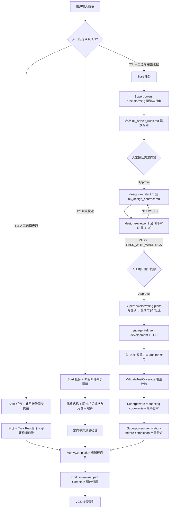

# Superpowers 自动化开发指南

> **任务模式更新**：新修改优先使用 `ai-sop.ps1 Task`。默认 T2，人工指定优先。T1/T2/T3 属于本次修改，不由风险关键词或历史功能产物自动决定。未带 taskId 的旧命令仍保留兼容语义，下面的旧功能级证据说明不覆盖任务模式。

## 任务状态、异常恢复和验证命令配置

`ai-sop.ps1 Status` 与 `Task -Operation Status` 使用同一任务摘要；支持 `-Feature`、`-TaskId` 筛选。Discover 显示相同的任务/归属/会话信息而不扫描全部验证输入。摘要中的 `recordedApprovals` 是批准记录展示，`EXECUTION_EVIDENCE_CURRENT` 只说明执行证据适用；`APPLICABILITY_RECORDED` 表示含不适用声明，不是未运行的命令通过，完整 T3 收尾仍使用 Verify。

Status/Discover 默认输出简明文本，列出未完成任务及仍有待同步项的历史任务。指定 `-TaskId` 始终显示该任务；`-IncludeHistory` 查看完整历史。自动化请使用 `-Json`：输出单个 JSON 文档，固定包含 `schemaVersion: "1.0"`、`operation`、`workspace`、`tasks[]`、`warnings[]`（空结果仍为数组），契约见 `schemas/task-status.schema.json`。原逐行 JSON 调用需加 `-OutputFormat JsonLines`；不要解析默认文本。Start 遇到已存在的 TaskId 会提示使用 Resume，不会恢复旧任务或忽略新目标；Resume 保留原目标，新目标使用新 TaskId。

DONE/CANCELLED 默认显示 `HISTORICAL_NOT_RECHECKED`，保留已记录的终态、失败记录与待同步项，不用后续代码变化重新判旧任务“需要处理”。这不表示历史证据仍适用于当前代码。需要复核时使用 `Status -TaskId <任务> -RecheckHistory`，或 `Status -IncludeHistory -RecheckHistory`；JSON 的 `verificationScope=CURRENT_INPUTS` 表示本次显式核对，结果不改变任务状态。Discover 始终不扫描输入，不接受 RecheckHistory。

正常切换 Agent 用 Resume。异常中断、本地 owner 丢失、或接收到没有本地 owner 的 ACTIVE 任务时，先 Status，再 `Task -Operation Recover`，恢复为 PAUSED 后 Resume。Recover 不把任务标成完成，不导入其他工作区的权限。若原会话仍标记 ACTIVE/IDLE，先确认旧 Agent 已停止，再显式使用 `-ForceRecovery -Notes "恢复原因"`；本机验证进程还在运行时，即使带该参数也会拒绝恢复。旧 ForceRelease 也会同步暂停任务、清除原会话绑定，使用同一事务。

Start、Resume（含旧 owner 收编、同会话续接及跨会话转移）和会话绑定都会在同功能归属锁内检查其他 ACTIVE 任务；即使本地 owner 注册表为空，也不能绕过同步来的未结束任务。`TASK_ACTIVE_CONFLICT:<taskId>` 指出需要继续或恢复的任务；独立新任务可在旧任务 Suspend/Recover 为 PAUSED 后启动，无需先通过旧任务完成门禁。冲突检查不阻止 Suspend、Cancel 或 Recover 清理占用。该检查仅覆盖本工作区已同步的状态，不是跨机器实时分布式锁，不支持同功能并行写入。

Task Verify 和 Complete 使用相同的批准文件定位规则：优先 `00_workflow_state.json`，不存在时兼容 `workflow-state.json`。带 TaskId 的 T3 AssessRisk 在任务基线缺失、损坏或无法读取时返回 JSON，包含 `TASK_SCOPE_UNAVAILABLE` 和实际原因；此时 `changeSetDigest` 为 null，不能解释为“无变化”。该诊断不改任务档位、归属或批准记录。

跨会话 Resume 遇到仍为 ACTIVE/IDLE 的旧会话，需要 `-ConfirmTakeover`，记录有意交接。用户已明确要求切换且旧 Agent 已停止时直接使用，不重复询问；普通 Checkpoint 不会借用旧 owner 的会话身份。Task 写操作可从唯一的 CODEX_SESSION_ID / ANTIGRAVITY_SESSION_ID 推断 Agent，否则显式传 `-Agent`。没有原生会话环境变量的 CLI 应为同一次会话设置稳定的 `AI_SESSION_ID`，跨进程调用保持一致；不能用读取 owner 的方式冒充该会话。

宿主可在 `.ai-workspace/context/verification-commands.json` 配置常用命令（由项目上下文仓库管理）：

```json
{
  "schemaVersion": "1.0",
  "commands": {
    "build": {
      "kind": "compile",
      "executable": "pwsh",
      "arguments": ["-NoProfile", "-File", "./scripts/build.ps1"]
    },
    "regression": {
      "kind": "test",
      "batch": "regression",
      "executable": "pwsh",
      "arguments": ["-NoProfile", "-File", "./scripts/test.ps1"],
      "timeoutSeconds": 600
    }
  }
}
```

脚本由宿主提供。执行 `Task -Operation Run -Feature Example -TaskId fix-1 -Agent CODEX -Profile build` 即可调用；配置采用参数数组，工作目录固定为宿主根目录。T3 测试配置可加 `caseIds`。Profile 不与显式 Kind/Executable/Arguments/Batch/CaseIds/JUnitReports/CaseMap 混用，避免实际命令与配置不一致；超时可用 `-TimeoutSeconds` 覆盖，0 表示不限制。

Run 在启动前持久保存 RUNNING，再持续输出并写入任务日志，结束时更新为 PASSED、FAILED 或 TIMED_OUT。异常退出可能留下 RUNNING；Status 根据本机进程身份（PID 与启动时间）区分仍运行和已中断，Recover 将已停止的尝试记为 INTERRUPTED。远端进程无法本地确认，需要先确认原执行已停止。超时会终止本次启动的进程树并记录退出码 124。查看实时日志可使用 PowerShell 的 Get-Content -Wait；停止运行器后，后续 Agent 应检查是否还有遗留子进程。

Run 自动续期当前绑定会话，不重新激活已结束或已转移的会话。运行中的会话检查/续期遇到锁竞争，会在最后确认的原租约有效期内退避重试，连续重试最多 30 秒；租约到期、身份变化或其他协调错误会停止子进程，记为 INTERRUPTED 并保留 RUN_CONTROL_INTERRUPTED 诊断，不冒充测试断言失败。执行结果先原子保存到任务目录的 `<runId>.pending.json`，再通过事务入账；只有成功入账才删除待保存文件。事务失败时可用 `Task -Operation RetryEvidence -Feature Example -TaskId fix-1 -Agent CODEX -RunId <id>` 重试保存，不重新执行命令。会话已结束/到期时，待原进程停止后 Recover：匹配的本地终态结果会随恢复事务保存，再 Resume；没有有效终态结果才记 INTERRUPTED。旧任务的终态 owner 不阻塞另一任务的恢复。

同一 kind/batch 的重跑保持命令、Profile 和 CaseIds 范围一致。确需更换时在 Run 提供 `-Reason "调整验证命令/范围的具体原因"`，保留旧尝试及替换关联；不得改用无关成功命令掩盖失败。修复代码后用原命令重跑不需要额外参数。

新 Profile 证据使用 `profile-command-v1`，只绑定所选命令的规范化定义（命令及参数顺序、kind/batch、CaseIds、默认超时和可选报告/映射配置）。JSON 排版、键顺序或其他 Profile 的有效改动不使它过期。Status/Verify 及 Run 结束时都会核对当前定义；所选命令删除、损坏或语义改变会指出具体批次。按新定义重跑同批次时带 Reason，不重填旧摘要。旧 Profile 记录仍按原整文件摘要核对，不重新解释为新语义；格式升级后的首次重跑也可能需要 Reason。

可选 JUnit 映射另保存 `junit-map-v1` 与工作区内的来源路径，映射内容变更、删除或越界会使相关证据失效；单纯 JSON 排版、对象键序和 Case 排列变化不影响新绑定。Run 期间变更所用定义会保存失败结果，即使命令退出码为 0。旧映射记录若没有来源路径，会提示 `JUNIT_MAP_SOURCE_UNBOUND`，继续当前任务时重跑相关批次以建立绑定；不猜测文件来源、不改写历史 DONE。Profile 与报告映射继续可选，不给普通 T1/T2 新增必填配置。

T1/T2 的 Run 不读取历史需求设计和覆盖矩阵，历史损坏的覆盖 JSON 不会阻断轻量编译/测试。完整 T3 测试仍绑定规格摘要。未结束的运行会阻止 Complete、Suspend 和接管；失败/中断的必需测试批次需要同批次成功复跑，不能用旧成功记录覆盖。

## Guard 拦截与事务不确定状态

`OWNER_REQUIRED` 表示缺少有效执行归属。先 Discover 识别当前功能和任务：独立修改 Start，继续原任务 Resume；异常中断先 Status / InspectRecovery，再 Recover → Resume。不要创建临时 ownerId 直接 Claim。接管不依赖固定提示词；需要强制恢复时，先确认原 Agent 已停止，并检查验证进程状态。

`WORKFLOW_TRANSACTION_INDETERMINATE` 表示事务恢复不能确定目标状态，不等于普通的遗留归属锁。保留报错中的 journal 路径与目标文件，在宿主根目录执行只读诊断：

```powershell
pwsh -NoProfile -File ./ai-sop.ps1 Preflight -Feature <FeatureName>
```

Preflight 列出本地未决事务等问题，不修复、不抢锁，也不表示门禁通过。只读检查 journal 的 phase、目标路径与前后快照及相关错误；路径未知时用预检定位，不猜测注册表目录或批量清理。排除已确认的 IO/环境原因后重试原操作，由事务协调器在锁内校验并回滚/重放。若目标既不匹配前像也不匹配后像、记录损坏或来源不明，停止写入并报告实际差异，需要针对该事务诊断修复；目前没有通用的强制修复命令。

**禁止删除 journal、改写快照或 ForceRelease 来消除报错**；日志清理由协调器成功恢复并校验目标后完成。Task Recover 处理任务中断与归属，不是跳过事务一致性检查的入口。这样的暂停只针对真实的状态一致性故障，不给普通 T1/T2 增加新门禁。

## T3 的任务基线和必测范围

新任务记录 `baseline`：VCS 类型和启动时版本用于追溯，功能 owner/feature-state 的长期基线不因此改变。`startInputs` 与任务创建一起通过事务保存，绑定 taskId、feature、创建时间和创建事务，引用原始内容清单。Resume、Run、Recover 均不重新采集这个起点。必须先 Start 再修改代码；启动前已有改动不自动归属于新任务。

T3 Start 总是完整采集。T1/T2 默认只尝试预算为 500ms、读取量最多 8MiB 的内容采集，完整结束才保存清单；超出预算或读取失败则记 UNAVAILABLE，不保存部分清单，不阻塞普通编译/测试或强制升档。这是扫描预算，不是整个 Start 或底层文件系统 IO 的硬超时。若预期申请“不适用”或之后升级 T3，可在修改前显式使用 `Task -Operation Start ... -CaptureBaseline`，完整采集而不改变任务强度。T1/T2 仍无需下面的 T3 范围登记。

Start 成功后立即输出 `TASK_START_INPUTS`：CAPTURED 表示起点已保存，后续操作仍需满足各自规则；UNAVAILABLE 同时给出原因和限制，普通本档验证仍可继续。反馈读取已有任务记录，不额外扫描输入、不询问确认或自动扩大预算，也不允许修改后重建起点。

在宿主根目录运行：

```powershell
& ./ai-sop.ps1 Task -Operation Changes -Feature Example -TaskId change-1
& ./ai-sop.ps1 Task -Operation SetCaseScope -Feature Example -TaskId change-1 -Agent CODEX `
  -CaseIds @('TC-CURRENT', 'TC-REGRESSION') -Reason '本次调整的行为及共享路径回归'
```

`Changes` 为只读 JSON，返回任务基线到当前输入的新增、修改、删除文件及前后哈希、`changeSetDigest`。未改变的启动前脏文件不属于本任务差异；暂存/提交不会改变该摘要。编译和测试仍绑定保守的完整输入，不能因文件不在任务差异中而忽略共享依赖变化。

T3 确需 04 影响分析时，在 `.ai-workspace/specs/features/<Feature>/04_change_impact.json` 填入当前 `taskId`、`baseline`（任务的 revision）、`baselineInputDigest`、`changedFiles`（完整差异路径）及 `changeSetDigest`，并实际更新行为分析。ReviewImpact 校验绑定并保存 `.ai-workspace/specs/.artifacts/changes/<sha256>.json`；后续 Verify 再检查文件、输入和差异清单。该清单与 inputs 清单一起在 specs 仓库同步。不要用旧功能基线计算出的 diff 哈希填入任务模式。语义扫描按任务差异文件筛选；同一文件在启动前已有改动时仍保守纳入 VCS diff，无法读取差异时要求影响分析，不静默跳过。

新任务 Start 同时记录 `startImpact`：04 不存在、已保存摘要或读取失败。T3 校验允许忽略启动前已有且未修改的历史 04（包括没有 taskId 的旧文件）；本任务新增、修改的 04 必须关联当前 taskId，已记录或审核的 04 删除后也不能静默跳过。Resume、升档不重建这个起点。旧任务缺少 startImpact 时保留兼容并明确提示来源未核实，不声称已证明文件未变；已有 impactReview 的归属仍必须匹配。

新建的 startImpact 和 ReviewImpact 使用标记 `hashAlgorithm=sha256-text-lf-v1`，仅把 04 文本中的 CRLF 转为 LF 后计算摘要；Git 换行转换不会让新记录失效，文字、空白或字段改动仍使摘要变化。没有算法标记的旧记录继续按原始字节校验，不自动迁移；旧审核可在核实内容后重新 ReviewImpact，旧启动快照则保持不变。源码输入、inputs/changes 内容寻址清单和 Profile 摘要的规则不受此变更影响。

SetCaseScope 记录本任务必测用例和原因，保留变更历史。ID 必须存在于覆盖矩阵，且包含当前 04 声明的 requiredRegressionCases；需求、设计或测试定义修改后需重新核对登记。T3 验证这些用例的载体、断言及执行结果，不把功能内其他尚未开发用例强制加入本次执行；功能规格批准、哈希及整体覆盖定义仍检查。不能通过缩小范围掩盖已发生的失败批次。

ValidateTestCoverage 输出 `COVERAGE_SCOPE`，区分功能范围、本任务范围和未选择范围。T1/T2 未登记用例范围时可以完成本档验证，但覆盖命令只输出 `VALID_CONTRACT_ONLY` 和未检查载体/断言的提示；T3 空范围仍失败。用例在矩阵中存在但不在本任务 SetCaseScope 中时，诊断会明确指出范围遗漏。

显式 ChangeTier 升到 T3 时自动复用本任务的 startInputs，保留 T1/T2 阶段已有改动；没有可信起点则拒绝升级并保留原档位。`SetBaseline -BaselineInputsRef <sha256> -Reason ...` 也只接受本任务创建时登记的同一引用，不能凭理由导入任意 manifest，更不能采用修改后 Run 的清单。已设定的基线不可重置。

旧版直接在 T3 Start 创建的 baseline（source=START）继续可用；历史 DONE 不迁移。旧版手工 ADOPTED 基线、缺起点的旧任务不能被当成机器已验证的修改前状态。缺文件时从原工作区恢复原 task.json 和引用清单；从未采集过起点则不能事后补造，已有 T1/T2 可照常执行本档验证收尾。此类历史 T3 应核实完整改动范围后用原引擎收尾，再切换新引擎。接收含 startInputs 的新记录时，各 Agent 引擎需同步升级。

## 可选 JUnit XML 映射

宿主维护映射文件，例如 `.ai-workspace/context/junit-case-map.json`：

```json
{
  "schemaVersion": "1.0",
  "cases": [{ "id": "TC-CURRENT", "className": "example.CheckTest", "name": "currentBehavior" }]
}
```

```powershell
& ./ai-sop.ps1 Task -Operation Run -Feature Example -TaskId change-1 -Agent CODEX `
  -Kind test -Batch regression -Executable pwsh -Arguments @('-NoProfile', '-File', './scripts/test.ps1') `
  -JUnitReports @('build/test-results/TEST-example.CheckTest.xml') `
  -CaseMap '.ai-workspace/context/junit-case-map.json'
```

Profile 可使用 `junitReports` 和 `caseMap` 同名字段。配置二者后不另传 CaseIds，成功用例从本次报告的精确 classname/name 映射生成。报告路径是宿主内的明确文件，不支持 glob；命令须生成或更新报告，旧文件、缺失、跳过、映射未命中、失败/错误均不能充当通过，进程退出 0 也不例外。重复同名测试必须全部通过。输出目录应按实际构建配置排除，不能为通过检查而排除源码。映射和报告路径绑定批次定义，调整需 Reason；原始 XML 可保留本地，持久执行记录保存报告摘要及通过的 CaseIds。此功能核对正常工具输出，不证明本地进程无法伪造 XML；T1/T2 不强制启用。

报告提供的 `tests`、`failures`、`errors`、`skipped` 汇总须为非负整数，成功报告的汇总须与 testcase 明细一致。嵌套 suite 按其后代用例核对，报告总数不重复累加父子汇总；映射外的跳过用例不影响已映射用例通过。

## 损坏执行结果的恢复

先用 `Task -Operation InspectRecovery -Feature Example -TaskId change-1` 只读检查 task、owner、session 和待入账结果。任务/权限记录损坏时需可信备份或事务恢复，不能删除后猜测重建。待入账结果损坏或身份不匹配时，默认 Recover 明确报错；确认原执行停止且结果不可信后，可用 `Recover -QuarantineInvalidEvidence -Reason "损坏原因和重跑安排"`，会话仍活跃时还需 ForceRecovery。

隔离先原样备份到 `.ai-workspace/.runtime/quarantine/`，再通过恢复事务把尝试记为 INTERRUPTED、任务记为 PAUSED，并在 lastRecovery 保留路径和哈希。成功提交且原文件未变化后才清除原待入账文件；事务失败保留原文件。备份留在源机器，接管端能看到审计引用但不要求同步备份，也不会把坏结果当成功。Resume 后重跑相关批次。

## 独立修改、续做与暂停

1. `pwsh -NoProfile -File ./ai-sop.ps1 Task -Operation Discover` 查看候选；讨论不认领。
2. 独立修改使用 `Task -Operation Start -Feature Example -TaskId fix-1 -Tier T2 -Objective "修复既有行为" -Agent CODEX`。
3. 中断后使用 `Task -Operation Resume -Feature Example -TaskId fix-1 -Agent CODEX`；任务身份和档位不变。旧 ACTIVE owner 可省略 TaskId 显式收编，不重置批准。
4. 使用 Run 执行真实构建与测试，自动保存成功/失败和输入指纹。参数数组推荐在 PowerShell 中调用：

```powershell
& ./ai-sop.ps1 Task -Operation Run -Feature Example -TaskId fix-1 -Agent CODEX `
  -Kind compile -Executable pwsh -Arguments @('-NoProfile', '-File', './scripts/build.ps1')
& ./ai-sop.ps1 Task -Operation Run -Feature Example -TaskId fix-1 -Agent CODEX `
  -Kind test -Batch regression -Executable pwsh -Arguments @('-NoProfile', '-File', './scripts/test.ps1')
```

命令和脚本路径由宿主工程提供，以上仅展示参数形式。原生可执行程序直接调用；Windows 批处理可经显式 `pwsh -Command` 调用，参数作为数组传递，不拼接不可信 shell 文本。T3 测试带 `-CaseIds @('TC-ONE','TC-TWO')`，根据真实运行结果映射；也可选用下方 JUnit XML 映射；其他框架仍由控制器依据真实输出声明 CaseIds。

可执行文件的相对路径按宿主工作区解析，与调用端当前目录无关。`.ps1` 使用 `pwsh -File`；`.bat/.cmd` 使用显式宿主调用，直接传给 Executable 会得到明确诊断。SVN CLI 缺失仅跳过 Run 的版本号注记并提示；真正依赖 SVN 的基线/版本操作仍需要相应工具。

5. 每阶段 `Task -Operation Checkpoint ... -NextAction "下一步" -Notes "已完成与未解决项"`；环境阻塞或离开时 `Suspend` 保存暂停并释放执行占用。取消用 Cancel，均不宣称完成。
6. `Task -Operation Verify ...` 列齐缺失/失败批次、变化文件和 T3 规格问题；通过后 `Complete`。T3 要求的影响分析必须经检查，再用 ReviewImpact 显式记录当前分析与代码绑定，禁止盲目刷新哈希。

T1 只需真实编译/基础检查；T2 还需相关测试和 RecordSync 记录受影响规格/用例的同步结果，均不背负原功能历史 T3 收尾。涉及原契约语义变化要明确告知用户，不能把原批准当成新语义已批准。暂停任务与独立新任务可以顺序存在；同功能不同时推进两个独立主会话。

不同功能并行继续采用独立工作区和测试数据隔离；最终组合重新验收。跨工作区恢复先 Suspend、同步任务/规格与代码，接收端 Resume 取得本地会话。Discover/Doctor 若提示 SPECS_IGNORED，应检查提示中实际管理规格的 Git 仓库。若 `.ai-workspace` 和 `.ai-workspace/specs` 是两个独立仓库，应分别同步项目上下文和功能规格/任务记录，父仓库忽略 `specs/` 属正常隔离；工具不会擅自提交存量文档。

任务内容指纹排除暂存状态、日志及常见构建输出，但保守包含公共输入。它不是完整的环境快照；服务、工具链或外部依赖变化时仍应按实际风险重新验证。详细约束见 `workflows/shared-artifacts.md`。

当前算法为 `inputs-v2`：修复源码中同名 build/bin 等目录被漏扫，排除 worktree 的 .git 文件、滚动日志和根目录 .ai-sop-staging。常规输出目录仅在工作区根或可识别的 Maven/Gradle 模块根排除；有 web.xml 的 WEB-INF/classes 作为标准 Java Web 编译输出排除，web.xml 本身仍是输入。升级会使旧 inputs-v1 执行证据过期，下一次相关验证重新采集；不重写旧成功记录的哈希，不撤销历史 DONE 任务。

宿主可以在 `.ai-workspace/context/verification-inputs.json` 调整输入范围：

```json
{
  "schemaVersion": "1.0",
  "include": ["build/handwritten", ".ai-workspace/context/runtime-contract.json"],
  "exclude": [
    { "path": "generated-output", "reason": "构建生成目录，不包含手写源码或构建配置" }
  ],
  "nonExecutable": [
    { "path": "docs/operator-guide", "reason": "仅供人工阅读，不被构建、测试或运行时代码消费" }
  ]
}
```

`include` 是补充纳入被默认规则排除的真实输入，不是限制扫描范围的白名单；未列出的公共代码仍检查。`exclude` 排除明确的生成文件或目录，必须说明原因。均为宿主根目录下的字面路径，匹配自身及子目录，不支持 glob、绝对路径或 `..`。更具体的路径规则优先；显式 include 可以覆盖同路径的默认排除，不能覆盖更深层的输出或日志排除；同路径同时写 include/exclude 则报配置冲突。Windows 下冲突判断不区分大小写。include 目标必须预先存在，适用于真实源码或测试夹具，不用于构建后才生成的目标文件；不能纳入 VCS、引擎、规格和运行时目录。修改配置前应核对共享依赖，不应为了通过门禁而排除源码。机器检查配置格式及路径边界，不证明排除理由的语义；不自动采用 Git/SVN ignore 作为验证依据。

例如 include `module` 仍排除可识别模块下的 `module/build`、`module/target`；显式 exclude `module/build` 也优先于父目录 include。需要其中的手写夹具时，include `module/build/fixtures` 可重新纳入该子目录，兄弟输出仍排除。`app.log.2026-10-15.gz` 等日期滚动日志默认排除；确为测试输入时可 include 其精确路径。`app.log.config` 之类的普通文件不按滚动日志排除。

配置结构仍为 schemaVersion 1.0，新匹配语义使用绑定配置摘要的 `inputs-v4`，旧 v3 清单可读取但不能复用为当前成功证据；新增/更改/移除配置也会使执行证据过期。无配置继续 v2，仅实际受日志排除修正影响的输入摘要变化。使用 v3 基线的活动 T3 应在原引擎完成后升级，避免中途改变差异口径；升级后不重填旧基线或成功哈希。历史 DONE 不迁移，接收 v4 清单的 Agent 引擎需同步升级。

新 Run 将完整清单按内容哈希去重保存到 `.ai-workspace/specs/.artifacts/inputs/<sha256>.json`，task.json 仅保存 `inputsRef` 和输入摘要。这部分须随规格 Git 一起提交、同步；只复制功能目录不足以交接新记录。缺失、损坏或摘要不匹配会明确诊断，不能冒充成功。旧内嵌清单仍可读取，无需迁移历史任务；接收新记录的引擎需要升级到支持 inputsRef 的版本。日志默认写入 `.ai-workspace/.runtime/verification/<Feature>/<taskId>/<runId>.log`，该本地目录自动放置忽略规则，不随规格同步；日志缺失不等于执行失败，结果依据持久证据判断。旧日志路径仍可读取。

单次 Status 和 Verify 的任务校验共用一次输入快照和规格摘要；下一次调用重新扫描。Run 前后始终分别扫描，不能缓存掉运行期间的输入变化。Status/Discover/Doctor 会提示宿主入口、AGENTS 投影或引擎锁版本不一致；这是部署提醒，不增加 T1/T2 完成门禁。缺少引擎时 Task/Status 明确提示初始化。旧功能会显示 LEGACY、档位、阶段及本地归属；T3 的损坏规格 JSON 会标出文件和错误，T1/T2 不因历史损坏规格而被迫补跑完整流程。

### 按需解释输入范围

```powershell
& ./ai-sop.ps1 Inputs -InputPath @('src/example.txt', 'module/build/output.bin')
& ./ai-sop.ps1 Inputs -InputPath 'module/build/output.bin' `
  -CandidatePolicy '.ai-workspace/context/verification-inputs.candidate.json' -Json
```

`Inputs` 复用真实扫描规则，显示路径是否纳入、获胜规则、命中的 include/exclude、默认排除原因，以及扫描条目数、哈希文件数、实际读取的输入内容字节数、耗时和最大的 10 个输入文件。被剪枝目录的子文件按祖先规则解释，不为诊断额外读取其内容；统计不含目录元数据及配置读取开销，耗时仅代表这次诊断。

`CandidatePolicy` 是宿主根下的候选 JSON 字面路径，结构与正式配置相同；建议放在上述 context 目录。预览报告列出新增/移除输入及策略摘要是否变化，不安装配置、不保存证据。命令完整扫描一次，候选比较再扫描一次，只在排查时使用，不自动加入 Start。比较期间继续改文件可能影响结果；报告会指出共同输入的内容变化，正式采用前应在文件稳定时复核。即使文件集合不变，配置摘要变化也可能使旧证据过期。

### 按需检查交接和升级

```powershell
& ./ai-sop.ps1 Preflight -Feature Example -TaskId change-1
& ./ai-sop.ps1 Preflight -TargetEnginePath '../agent-sop-next' -Json
```

`Preflight` 列出任务目标、检查点、非阻塞待办、需同步的 task.json、功能规格、inputs/changes 引用清单和项目验证配置；按实际所属 Git 仓库显示 TRACKED/UNTRACKED/IGNORED 及本地改动，适用于 `.ai-workspace` 与 `specs` 分别独立 Git 的布局。项目 context 和功能目录整体也列为同步范围，以覆盖自定义引用与附件。有清单引用时，syncRoots 同时列出 `.ai-workspace/specs/.artifacts/`；可同步整个目录，也可按 artifacts 中逐条列出的引用文件同步，不能只复制功能目录。TRACKED 不代表已推送或目标机器已收到；代码、共享依赖和规格需对应同一实际版本。

预检读取清单并校验哈希，同时检查本机归属/会话、未完成运行、损坏 pending 结果和未决事务。它不读取业务源码内容、不编译、不抢锁、不续期、不执行事务恢复，也不修改完成状态。运行中的命令或 pending 结果应先在原工作区处理；本机注册表、事务日志及 `.runtime` 不作为可移植归属复制，接收方仍通过 Resume/Recover 获取本机执行权。

没有 taskId 的旧功能也会列出根目录规格、嵌套仓库和同步范围，JSON 中放在 `legacyFeatures`，标记 `LEGACY_UNVERIFIED`。批准字段只展示原记录，不能据此宣称哈希或完成门禁有效；不会创建任务或采纳旧归属。明确指定不存在的 TaskId 仍报告选择为空。活动任务还会检查所选 Profile/JUnit 映射是否改变，并列出对应来源文件；目标引擎未声明支持这些绑定时提示兼容缺口。

Preflight 将清单文件损坏与任务引用不匹配分开：文件有效但某条 inputDigest 或差异基线绑定不符时，诊断归属具体任务/记录，不把共享文件标为损坏。历史任务的本地归属显示 NOT_APPLICABLE，损坏任务显示 NOT_CHECKED。InspectRecovery 和 Preflight 都核对任务、Owner、工作区及会话绑定；OTHER_TASK 代表本地 Owner 属于其他任务，不读取它的会话作为当前任务的有效身份。

省略 `TargetEnginePath` 只检查运行此命令的引擎；提供候选引擎目录时，读取其 `config/runtime-compatibility.json` 和任务 Schema，不执行候选脚本。目标缺少兼容性声明显示 UNKNOWN，不能推断安全；声明及 Schema 通过也不是完整发布认证。活动 T3 的基线算法或配置口径不兼容时，会提示在原引擎收尾。T1/T2 起点不兼容时，提示后续升级/豁免的限制，正常档位验证仍可执行；历史 DONE/CANCELLED 不重新按当前输入判断完成与否。

旧安装没有 Preflight 入口时，可直接运行候选引擎的 `scripts/preflight.ps1 -WorkspacePath <宿主根目录>`，先检查再决定升级。没有指定 Feature/TaskId 时检查未结束或有待同步项的任务；`-IncludeHistory` 纳入全部历史。`-Json` 输出 schemaVersion 1.0 的单个报告。发现问题时返回 NEEDS_ATTENTION，但报告成功生成仍退出 0；参数、路径或执行错误才失败。结果是非原子的即时观察，不代表目标代码相同或远端同步成功，也不是新门禁，不要求每个 T1/T2 任务先执行。


本指南说明多个 harness（Claude Code / GitHub Copilot / Antigravity / Cursor / Codex / Pi）如何使用本项目的 AI SOP 完成游戏服务端开发。**T3 由 Superpowers 过程引擎编排；T2/T1用 AGENTS.md + 专家 Skills，不调用 Superpowers**。领域专家 Skill 被强制绑定调用；详见 `.ai-sop/workflows/superpowers-adapter.md`。各 harness 共享 `.ai-workspace/context/` 与规范化功能产物。各工具的能力差异（能跑 T3 还是支持 T1/T2）见 `.ai-sop/scripts/harness-capability.ps1` 的 STRICT/BLOCKED 判定。

## 🧭 用户任务选择

- 日常任务直接描述，默认 T2；用户提供的明确需求可以直接实施。
- 时间紧时明确说“按 T1，先完成实现并编译”，可以用于紧急修复或协议调整。Agent 不重复要求确认。
- 希望完整需求设计、计划、审核和验证时明确说“按 T3”。复杂功能建议 T3，但最终由人工决定。
- 纯文档/配置不再构成第四档；按当前档位判断编译和测试的适用性。

## 为什么不需要声明流程模式

各 harness 统一以 Superpowers 为过程引擎（仅 T3）。用户明确选择 T3 后，Superpowers 才按阶段选择对应的过程 Skill；默认 T2 不调用这些完整流程节点：

| 任务形态 | Superpowers 自动选择的 Skill |
|---|---|
| 新功能或行为变更 | `brainstorming` |
| bug 与异常行为 | `systematic-debugging` |
| 需求/设计批准后实现 | `writing-plans` -> `subagent-driven-development` + `test-driven-development` |
| 交付前验证 | `verification-before-completion` |

**不要手动激活 `workflow-orchestrator` 作为顶层调度器**。它是 T3 主流程之外的**人工手动片段编排器**（当前用于全功能审计，可扩展），不是完整功能从需求到交付的调度器。完整 T3 功能统一走 Superpowers。

## 工作流概览

主流程为 Superpowers 原生骨架；领域专家 Skill 作执行单元/校验组件，不作流程节点。



需求与设计是两道独立门禁（默认两道独立确认，仅当符合 T3 小改动合并呈递豁免时允许一次呈递写入两道 SHA）；头脑风暴可连续产出 01→06 后呈递确认。设计产出后由 `design-reviewer` 机器闭环自审自修（不占人工时间），通过后才交人工确认。**GREENFIELD 不前置完整测试计划**（新功能 TC 在 TDD 中产出，覆盖校验在实现后）。**LEGACY_EXTENSION（旧系统加类型/改分发）例外**：抽 1–2 个共享同一分发的 `IDENTICAL_TO_LEGACY` 表征 Case，必须在改生产代码前写好，并能在当前基线上跑绿（锁的是已有限购/重置/补偿，不是尚未实现的新类型；不是每个旧类型一条 Case）。`implementation-auditor`/`logic-auditor` 是 subagent 内审执行单元，非实现后独立节点。旧系统扩展的人工总体审核按协议脚本走，见后文模板 11b。复杂大功能交付后可**手动**触发全功能审计（见后文）。

### 执行强度档位（T 档）与提示词指定

默认 T2，人工明确选择优先。相同任务可按时间要求选择不同档位，Agent 不因风险分析自行改档。

| 档位 | 选择方式 | 完成要求 |
|---|---|---|
| T1 极速 | 人工明确选择 | 实现及真实编译；确有延期才记录待同步事项 |
| T2 快速 | 默认，或“快速修改” | 实现、相关需求/设计/用例同步、编译与相关测试 |
| T3 完整 | 人工要求完整流程 | 完整 Superpowers 流程，复用仍有效的成果 |

工具能力不足以执行 T3 时说明缺口，不能自动降档。接管保留原任务档位；独立新任务不继承历史 T3。

### 同步记录、人工改档和适用性

以下命令由 Agent 根据实际工作自动执行，不要求用户填写表单。示例中的目标、范围和依据必须换成真实内容。

```powershell
& ./ai-sop.ps1 Task -Operation RecordSync -Feature Example -TaskId fix-1 -Agent CODEX `
  -Documentation UPDATED -Tests UNCHANGED -Summary '更新 06 的响应规则；既有 ResponseTests 覆盖此次恢复行为'
& ./ai-sop.ps1 Task -Operation ChangeTier -Feature Example -TaskId fix-1 -Agent CODEX `
  -Tier T1 -Reason '人工要求先交付联调' -UserRequest '这次先按 T1，文档和测试稍后补'
```

RecordSync 的 UPDATED/UNCHANGED 是 Agent 的语义核对记录，不用新的文档哈希门禁证明语义正确；旧文档无需变化时无需为了完成表修改文件。T2 必须有这条简短记录，T1 不要求。T2 修改已批准规格的语义时先 ResetApproval，记录本次需求依据；无需当次走 T3 重新批准，但不得刷新哈希冒充旧批准仍覆盖新版本。

ChangeTier 只改变活动任务的交付要求，保留原 taskId、ownerId、历史执行结果及 tierHistory。必须记录人工请求，不能由风险扫描或工具故障代替人工决定；失败测试不会被改成通过。恢复暂停任务先 Resume，再按人工要求改档。升级 T3 后须满足 T3 的规格、审核和测试要求，旧轻量证据不自动成为 T3 证据。

纯解释性文档等确无构建或可执行行为影响时，可在 T1/T2 记录适用性。项目应在 Start 前通过 verification-inputs.json 的可选 nonExecutable 列表声明这些字面路径及理由；这些文件仍进入指纹，不是 exclude。未声明的文件按可能影响构建/执行处理，不依据扩展名自动豁免。无需改变任何验证输入的治理文档修正，也可在起点完整时登记：

```powershell
& ./ai-sop.ps1 Task -Operation SetApplicability -Feature Example -TaskId docs-1 -Agent CODEX `
  -Kind compile -Applicability NOT_APPLICABLE -Reason '仅修正文档错字，无构建输入变化'
& ./ai-sop.ps1 Task -Operation SetApplicability -Feature Example -TaskId docs-1 -Agent CODEX `
  -Kind test -Applicability NOT_APPLICABLE -Reason '仅修正措辞，无可执行行为变化'
```

将 Applicability 设为 REQUIRED 可明确要求该验证（包括 T1 中人工要求的相关测试）。NOT_APPLICABLE 同时绑定 startInputsRef 与当前输入：创建时和 Verify 时都比较起点，所有新增/修改/删除的验证输入必须属于预先声明的 nonExecutable 范围，输入算法和策略须与 Start 一致。先改源码再写“只改文档”、事后扩大豁免路径、缺起点或旧声明未绑定起点，均不能跳过验证；正常执行本档编译/相关测试即可，不要求因此升级 T3。原有 NOT_APPLICABLE 可改回 REQUIRED 后正常验证。项目声明是否符合真实语义仍由维护者和 Agent 核实，机器不宣称理解业务含义。

测试失败、测试缺失、环境不可用不得写成不适用；尚未解决的失败也不能用此命令豁免。T1/T2 的源码修改默认需要编译，T1 仍默认不要求测试，T3 不接受轻量豁免。RecordSync 的 Tests=NOT_APPLICABLE 仅描述用例同步，不替代测试执行适用性。

### 待同步事项：可见但不阻塞

```powershell
& ./ai-sop.ps1 Task -Operation AddFollowUp -Feature Example -TaskId fix-1 -Agent CODEX `
  -FollowUpId response-doc -FollowUpKind documentation -Summary '补充新响应字段含义' `
  -Scope @('06_design_contract.md#响应字段', 'ResponseCodec#decode')
& ./ai-sop.ps1 Task -Operation FollowUps -Feature Example
& ./ai-sop.ps1 Task -Operation CloseFollowUp -Feature Example -TaskId sync-1 -Agent CODEX `
  -SourceTaskId fix-1 -FollowUpId response-doc -Disposition RESOLVED -Resolution '已在 06 响应字段节补充类型、空值及兼容行为'
# 后续发现修改被回退或解决不完整时，由当前活动任务重新打开
& ./ai-sop.ps1 Task -Operation ReopenFollowUp -Feature Example -TaskId check-1 -Agent CODEX `
  -SourceTaskId fix-1 -FollowUpId response-doc -Reason '文档修改被回退，需要重新补充'
```

- 仅实际延期才 AddFollowUp，稳定 ID 用于避免重试重复。documentation、test-cases、verification 分别表示待补文档、待补用例、待执行验证。
- 记录保存在来源任务的 `tasks/<taskId>/task.json`，随所属规格 Git 仓库同步。T1 完成或取消不自动隐藏 PENDING。
- Start/Resume 自动检查当前工作区；同功能显示详细事项，其他功能最多一行数量摘要。提醒后继续，不等待用户确认、不自行加入本次工作，不反复在执行中催办。
- 新 T2 只负责本次相关同步，不自动承担历史待办；如触及相同行为应指出关联，范围内可一起完成，范围外不扩展任务。
- CloseFollowUp 由当前活动任务执行；可关闭同功能历史任务的待办，保持原任务 DONE/PAUSED/CANCELLED 状态，以同一事务更新来源记录和当前任务。跨功能事项在对应功能的任务中处理。
- 取消解决任务时会以 FOLLOW_UP_CANCEL_REVIEW 列出该任务关闭的事项，提醒核实实际修改是否保留；提醒不阻止 Cancel 或后续 Start，不自动回滚关闭状态。确需重新处理时使用 ReopenFollowUp 并给出 Reason，将事项改回 PENDING，原关闭依据及重新打开的任务、时间保存在 resolutionHistory。来源任务的完成状态保持不变。
- 实际完成记 RESOLVED，Resolution 给出文件、用例或验证结果等具体依据；人工明确不需要处理记 NOT_NEEDED，并附 UserRequest。暂不处理仍保留 PENDING，不需要额外命令。
- Discover/Status 显示来源任务的待办，FollowUps 可集中查询。提醒查询失败仅报诊断，不阻止新任务。仅有标记不阻塞任何档位；相关 T3 整体验收仍需消除实际规格或验证缺口。

## 人机交互约定（以下完整编排仅 T3）

- 每轮最多 3 个关键问题，允许用户一句话给齐。
- 对有意义的备选方案进行比较并推荐其一。
- 需求与设计可多轮澄清与分段确认。
- 只有完整的 `01_server_rules.md` 与 `06_design_contract.md` 需要最终确认。
- 设计最终确认后，测试计划、审计、实现、验证、修复与回归自动连续完成，不再增设批准检查点。
- 当任务可独立 review 时，默认采用 `subagent-driven-development`，不让用户选择执行策略。

新修改先 Discover，再 Start / Resume；归属与进度由任务入口管理，默认 T2，人工指定优先。独立修改沿用功能名、创建新 taskId；完成用 Task Verify / Complete，中断用 Checkpoint / Suspend。下面的直接 Claim / Validate / Complete 仅用于没有 taskId 的旧流程兼容，不能作为新任务入口。各 harness 统一使用 `SUPERPOWERS` 归属，`agent` 区分实际工具。

```powershell
pwsh -NoProfile -File .\.ai-sop\scripts\workflow-owner.ps1 -Operation Claim `
  -SpecDirectory ".ai-workspace\specs\features/<FeatureName>" `
  -Feature "<FeatureName>" `
  -Workflow SUPERPOWERS `
  -Agent "<CLAUDE_CODE|COPILOT|ANTIGRAVITY|CURSOR|CODEX|PI>" `
  -OwnerId "<superpowers-run-id>"
```

`agent` 值取自实际工具，而非底层模型。Codex 使用 `CODEX`，旧接口直接 Claim 时从 `CODEX_SESSION_ID` 注册 session。PI 因核心无 subagent，支持 T1/T2，但无法运行要求独立审查的完整 T3；旧 Claim 经 `pi-adapter/bootstrap-pi-session.ps1` 注册 session。工具能力不会自动改变任务档位。

旧流程恢复或开始修改批次前用同一身份执行 Validate；成功交付后执行 Complete。失败不得宣称完成；任务模式使用 Suspend 保存未完成工作并释放执行占用：

```powershell
pwsh -NoProfile -File .\.ai-sop\scripts\workflow-owner.ps1 -Operation Validate `
  -SpecDirectory ".ai-workspace\specs\features/<FeatureName>" `
  -Feature "<FeatureName>" -Workflow SUPERPOWERS `
  -Agent "<CLAUDE_CODE|COPILOT|ANTIGRAVITY|CURSOR|CODEX|PI>" -OwnerId "<superpowers-run-id>"

pwsh -NoProfile -File .\.ai-sop\scripts\workflow-owner.ps1 -Operation Complete `
  -SpecDirectory ".ai-workspace\specs\features/<FeatureName>" `
  -Feature "<FeatureName>" -Workflow SUPERPOWERS `
  -Agent "<CLAUDE_CODE|COPILOT|ANTIGRAVITY|CURSOR|CODEX|PI>" -OwnerId "<superpowers-run-id>"
```

## 生产代码编辑 Guard

PreToolUse hook 在每次文件编辑前运行 `guard-production-edit.ps1`（同一脚本跨所有 harness：Claude Code 经 `.claude/settings.json`，其它经 `.agents/hooks.json`/`.cursor/hooks.json`/`.github/hooks/ai-sop.json`，hook 命令统一指向 `./.ai-sop/scripts/hook-dispatcher.ps1`）。编辑默认生产路径（`src/`、`pkg/`、`cmd/`、`internal/`、`app/`、`lib/`、`WebRoot/`、`config/`、`include/`；可由 `.ai-sop/config/project-policy.json` 的 `productionPatterns` 覆盖）前，必须存在 ACTIVE 的 `SUPERPOWERS` owner。guard 异常时可手动关（`.ai-sop/.guard-disabled` 开关文件）；更推荐一次性 `.guard-token.json`。详见《AI SOP 使用指南》。

`AI_SOP_SKIP_OWNER_GUARD=1`（或旧版 `SERVER_NEW_SKIP_OWNER_GUARD=1`）仅作为非功能型一次性小改（临时 hot-fix、探索性 probe）的逃生口。为绕过某次功能运行的归属而设置它是流程违规。

## 多功能并行开发

每个功能使用独立 Agent 会话和独立 SVN 工作副本（`svn checkout` 到独立目录）。不要在同一工作目录运行两个功能。

```powershell
pwsh -NoProfile -File .\.ai-workspace\scripts\feature-runtime.ps1 `
  -Operation Allocate -Feature "<FeatureName>" -WorkspacePath $PWD
```

每个功能获得独立端口、发布目录、`CATALINA_BASE`、日志和 BaseUrl。当前 Redis/Mongo 仍共享，因此代码、编译和 JUnit 可并行，正式 Tomcat/JSP 业务验证由机器级锁串行执行。详见 `.ai-workspace/workflows/parallel-development.md`。

## 使用模板

以下模板可直接复制，替换 `<...>` 即可。完整流程模板明确选择 T3，其余修改默认 T2，人工指定优先；Agent 不因任务名称或功能规模自行升级。无需手动声明 Skill。

只要任务涉及 `<FeatureName>`，提示词就应同时携带：

```text
规格目录：.ai-workspace/specs/features/<FeatureName>/。
```

功能名只用于定位任务，规格目录中的原始需求、`01_server_rules.md` 和 `06_design_contract.md` 才是业务规则与技术契约依据。

原始需求可直接粘贴，也可使用 `.md`、`.txt` 或 `.docx` 文件。旧版 `.doc` 需先转换，不得直接按 `.docx` 解压解析。

### 1. 完整新功能开发

```text
按 T3 开发新功能 <FeatureName>。
需求资料位于 .ai-workspace/specs/features/<FeatureName>/。
按完整流程执行；除需求和设计确认外，其余阶段自动连续完成。
```

Superpowers 会从 `brainstorming` 开始。用户只需在生成 `01_server_rules.md` 和 `06_design_contract.md` 后分别确认。

### 2. 尚未整理规格资料的新功能

```text
按 T3 开发新功能 <FeatureName>。
规格目录：.ai-workspace/specs/features/<FeatureName>/。
原始需求如下：
<粘贴需求内容>

请先将原始需求整理到规格目录并生成需求规则，按完整流程执行。
```

### 2a. 复杂 docx 需求预处理（可选前置）

策划给出复杂 `.docx`（混合客户端/美术/服务端需求）时，可**手动**先调用 `requirement-analyst` 预处理，产出服务端需求草案，再进 Superpowers brainstorming 定稿。

```text
使用 requirement-analyst 预处理 <FeatureName> 的策划资料。
规格目录：.ai-workspace/specs/features/<FeatureName>/。
策划文档位于 <docx 路径，已放入规格目录或给出绝对路径>。

请读取该 docx，剥离客户端与美术部分，提炼服务端需求，
产出 00_server_rules_draft.md（草案，非正式契约）。完成后停止，
列出待确认/模糊点，待我确认后进入 Superpowers brainstorming 定稿。
```

草案就绪后，用模板 1 启动 brainstorming，它会基于 `00_server_rules_draft.md` 交互澄清并定稿 `01_server_rules.md`。简单需求可跳过本步，直接 brainstorming。

### 3. 功能维护或需求调整

```text
调整 <FeatureName>。
本次调整内容：
<变更说明>

现有规格目录：.ai-workspace/specs/features/<FeatureName>/。
请先判断属于业务规则、技术契约、实现修复还是纯配置调整，再按对应流程执行。
```

业务规则变化进入需求确认，技术契约变化进入设计确认，纯实现修复不增加人工门禁。

### 4. 明确的业务规则调整

```text
调整 <FeatureName> 的业务规则。
规格目录：.ai-workspace/specs/features/<FeatureName>/。
调整内容：
<新的业务规则、公式、限制、状态或异常反馈>

请更新需求规则，并在人工确认后继续设计重校验和后续自动化流程。
```

### 5. 明确的技术契约调整

```text
调整 <FeatureName> 的技术契约。
规格目录：.ai-workspace/specs/features/<FeatureName>/。
调整内容：
<协议、存储结构、兼容策略、跨系统边界或实现方案变化>

现有需求规则不变。请更新设计契约，并在人工确认后自动完成测试计划、实现、审计和验证。
```

若分析发现调整同时改变业务语义，仍会先回到需求确认。

### 6. 实现偏差或指定代码修复

```text
修复 <FeatureName> 的实现偏差。
规格目录：.ai-workspace/specs/features/<FeatureName>/。
现象或问题：
<问题说明>

已确认需求和设计不需要修改。请完成回归用例、修复、编译、审计和自动化验证。
```

Superpowers 会复核“无需修改需求和设计”是否成立，不会仅根据提示词绕过人工门禁。

### 7. 纯配置数值调整

```text
调整 <FeatureName> 的配置数值。
规格目录：.ai-workspace/specs/features/<FeatureName>/。
调整项：
<配置文件、配置 ID、字段、旧值和新值>

业务语义、协议和存储结构不变。请执行配置检查和受影响场景回归。
```

### 8. 单个 Bug 排查

```text
排查 <FeatureName> 的 Bug。
规格目录：.ai-workspace/specs/features/<FeatureName>/。
问题现象：
<复现步骤、预期结果、实际结果和已有证据>

请先完成服务端判责；只有实现缺陷才修改代码，并自动完成回归、审计和验证。
```

Superpowers 会用 `systematic-debugging` 先定位根因。只有实现缺陷才修改代码；需求/设计缺陷回到对应人工确认；客户端、测试或无效问题只输出证据。

### 9. Bug 列表批量处理

```text
处理 <FeatureName> 的 BUGS.md。
规格目录：.ai-workspace/specs/features/<FeatureName>/。
Bug 文件位于 <BUGS.md 路径>。
请逐条判责、逐条输出结论；实现缺陷自动修复并回归，其他问题只输出证据。
```

实现缺陷自动进入测试计划、修复、审计和回归；客户端、测试或无效问题只输出证据。

### 10. 长周期大功能拆分

适用于一次改版/大功能无法一蹴而就、需拆成多个子功能分阶段交付的场景。**先拆功能级子项目到文档，再让每个子功能独立走完整 Superpowers 流程**（Superpowers 的 `writing-plans` 拆的是实现任务，不是功能级拆分，故需本前置）。

```text
长周期大功能 <FeatureName> 改版。
规格目录：.ai-workspace/specs/features/<FeatureName>/。
原始改版需求如下：
<粘贴改版需求>

本次为长周期任务，不要一蹴而就。请按以下步骤：
1. 先分析现有代码与逻辑，整理"现状基线"到规格目录（供改版对照）。
2. 通过 brainstorming 逐步确认改版需求与边界，产出改版总纲文档。
3. 将改版拆分为若干可独立交付的子功能（子功能级，非实现任务级），
   拆分计划写入文档，明确子功能间依赖与交付顺序。
4. 暂不实现。拆分计划待我确认后，每个子功能再各自独立走完整
   Superpowers 流程（需求→设计→design-reviewer 审查→确认→实现→审计→验证）。
```

拆分计划确认后，对每个子功能用模板 1（T3 完整新功能开发）启动，规格目录用各子功能自己的目录。每个子功能用 Task Start 创建任务、独立交付；不同功能在独立工作区可并行（遵循 `.ai-workspace/workflows/parallel-development.md`），同功能不并行多个主任务。全部子功能完成后，可用模板 11 做跨子功能审计。

### 11. 全功能审计（手动，人工把关）

复杂大功能交付后手动触发跨任务全盘审计。旧系统扩展必须按协议走旧类型（见模板 11b），不要只给 class/diff 范围。`audit_fix_policy` 取 `REPORT_ONLY`（只出报告）或 `AUTO_REPAIR`（自动修复并回归）。完整模板见后文 **"全功能审计"** 段。

### 11b. 人工总体功能审核（按协议脚本走旧类型）

旧功能加新类型、改公共分发后，人工总体审核用本模板，不要改成「再把整个功能读一遍」。

**协议脚本 ≠ 写新协议。** 不要为这次验收去加客户端包或改 proto。脚本 = 按固定顺序调用 `04.entryPoints` 里**已经存在**的正式入口。GM 只许 Arrange/Observe（造满额、拨时间、查库），禁止用 GM 当买入/领取 Act。

**也不必每个旧类型都点一遍。** 从 `IDENTICAL_TO_LEGACY` 抽 1–2 个共享同一分发的代表键。独立配置或独立分支的旧键，只对那一子集再各抽 1 个。新类型用自己的 FUNCTIONAL 验收，不能替代本脚本。

```text
对 <FeatureName> 做人工总体功能审核：执行协议脚本，不要按类/diff 审查，不要新写协议。
规格目录：.ai-workspace/specs/features/<FeatureName>/。

准备（从 04_change_impact.json 抄，不要发明新入口）：
- 写入入口（MUTATE）= <04.entryPoints 中的买/领/写>
- 查询入口（QUERY/INFO）= <成对查询；没有则写明 N_A 证据>
- 跨周期触发 = <拨时间 / 重置入口 / 会触发 RESET 的正式协议>
- 代表旧类型 typeKey = <IDENTICAL_TO_LEGACY 抽 1–2 个共享分发的键>
- 测试账号 = <隔离号>
- GM 白名单 = 仅造数/拨时/查库，禁止替代 Act

协议脚本（对人可复制执行；对 AI 必须留下追踪表）：
1. Arrange：把代表旧类型做到限购/计数满额。可用 GM 造数。用 QUERY 确认回包已满额。
2. 跨周期：推进时间过重置点。此步之后不要先发 QUERY。
3. Act：直接发 MUTATE 写入协议（绑定代表旧 typeKey）。这是「不先查直接买」。
4. Observe：看协议回包。然后冷重载（重登，或 DB/Redis 再读持久化字段）看次数/限购是否按旧规则重置或仍拦截。
5. 再发一次 QUERY，确认与冷重载一致。
6. COMPENSATE 切面不是 N_A 时，再走补偿/回放入口一次。
7. 记录：入口 id、typeKey、回包关键字段、冷重载字段、与改前基线是否一致。

通过标准：代表旧类型的限购/重置/「不先查直接写」与基线一致。看起来成功但次数没重置、或满额被击穿 = 失败。
不要把时间花在阅读新 Handler。新类型缺陷用 FUNCTIONAL Case / 新类型验收抓，不是本脚本的替代。
机器门禁：`CHARACTERIZATION` Case 的 `05_test_coverage.json` 必须含非 `N_A` 的 `assertions.persistenceColdReload`（带 `coldReloadEntity`），载体方法体须再读存储（`selectById` / `getById` / `findById` 一类）；否则 `VerifyCompletion` 报 `TYPE_EXTENSION_COVERAGE_INCOMPLETE`，已声明该层但方法体未再读存储则 `ValidateTestCoverage` 报 `COLD_RELOAD_INCOMPLETE`。
AI 收尾：requesting-code-review 与 logic-auditor 必须走 Mode E / Protocol Trace，附协议追踪表。
```

### 12. 对指定类执行全盘审计

```text
对指定类执行全盘审计。
目标类：<完整类名>。
文件路径：<类文件路径>。
所属功能：<FeatureName>。
规格目录：.ai-workspace/specs/features/<FeatureName>/。

优先派发独立子代理（Subagent）依次执行 implementation-auditor 和 logic-auditor 并汇总报告；若当前环境不支持子代理，则在主会话严格以只读审计角色依次执行。
audit_fix_policy=REPORT_ONLY。
审计范围仅限目标类及其必要的直接调用链，不扩大到整个仓库，不修改代码。
```

如果该类不归属于某个具体功能，可以删除“所属功能”和“规格目录”两行，但必须提供类文件路径和必要的契约来源。
> **说明**：全盘审计涉及深层调用链路与大量源码走查，推荐优先使用独立子代理（Subagent）隔离运行，避免海量上下文挤占主会话；在不支持子代理的环境下会自动降级在当前会话执行。

### 13. 对指定类的方法执行全盘审计

```text
对指定方法执行全盘审计。
目标类：<完整类名>。
文件路径：<类文件路径>。
目标方法：<方法名及参数签名>。
所属功能：<FeatureName>。
规格目录：.ai-workspace/specs/features/<FeatureName>/。

优先派发独立子代理（Subagent）依次执行 implementation-auditor 和 logic-auditor 并汇总报告；若当前环境不支持子代理，则在主会话严格以只读审计角色依次执行。
audit_fix_policy=REPORT_ONLY。
以目标方法、分支和必要调用链为审计边界，不扩大到整个类或仓库，不修改代码。
```

### 14. 只执行实现审计

```text
优先派发独立子代理（Subagent）执行 implementation-auditor（若不支持则在主会话执行）。
审核范围：<类、方法、文件列表或变更集>。
重点检查：<契约一致性、架构规范、性能、兼容性等；可省略>。
只输出审计报告，不修改代码。
```

### 15. 只执行高风险逻辑审计

```text
优先派发独立子代理（Subagent）执行 logic-auditor（若不支持则在主会话执行）。
审核范围：<类、方法或核心链路>。
重点检查：<状态机、复杂分支、结算、幂等、补偿、资源扣除等>。
只输出审计报告，不修改代码。
```

### 16. 只生成或更新测试计划

```text
仅执行 quality-assurance 的 PLAN 阶段。
功能：<FeatureName>。
规格目录：.ai-workspace/specs/features/<FeatureName>/。
只生成或更新测试计划，不进入实现。
```

### 17. 只执行 QA 验证

```text
仅执行 quality-assurance 的 VERIFY 阶段。
功能：<FeatureName>。
规格目录：.ai-workspace/specs/features/<FeatureName>/。
验证范围：<测试计划、用例、Bug 回归 Case 或目标场景>。
只执行验证并输出证据，不自动扩大到完整开发流程。
```

### 18. 只做需求分析

```text
仅执行 requirement-analyst。
功能：<FeatureName>。
规格目录：.ai-workspace/specs/features/<FeatureName>/。
原始需求资料位于 <资料路径；若已在规格目录中可删除本行>。
生成或更新需求规则后停止，等待人工确认。
```

### 19. 只做技术设计

```text
仅执行 design-architect。
功能：<FeatureName>。
规格目录：.ai-workspace/specs/features/<FeatureName>/。
需求规则已经有效确认。生成或更新设计契约后停止，等待人工确认。
```

### 20. 人工确认后继续

需求确认：

```text
确认当前 01_server_rules.md。
```

设计确认：

```text
确认当前 06_design_contract.md。
```

Superpowers 会校验当前文件、写入归属与确认状态，然后自动继续，不需要用户再次激活后续阶段。

### 21. 普通文档修改

```text
修改文档 <文件路径>。
修改目标：
<文档调整内容>

本次不改变业务规则和技术契约。完成文档检查后停止。
```

如果实际修改触及业务规则或技术契约，应重新分类，不能继续按普通文档任务处理。

## 领域专家调用（执行单元，非流程节点）

领域专家 Skill 是 Superpowers 的**执行单元**（subagent 派发）与**咨询/校验组件**，不是流程节点。使用其领域 checklist 与交付格式，把发现返回给 Superpowers controller，不接管编排、不写 `.ai-sop/runtime/`：

| 角色（执行单元/咨询） | 专家 Skill |
|---|---|
| 实现者 | `implementation-engine` |
| 每 Task 内审（实现/契约合规） | `implementation-auditor` |
| 每 Task 内审（高风险分支/状态/语义） | `logic-auditor` |
| 设计方案审查（人工确认前，机器闭环） | `design-reviewer` |
| 需求预处理（可选手动前置，复杂 docx） | `requirement-analyst` |
| 架构/契约设计（brainstorming 咨询） | `design-architect` |
| 测试覆盖校验（实现后） | `quality-assurance` / `test-plan-auditor` |

任何编辑规范产物的专家调用都属于修改型工作，需要活动的 Superpowers owner ID；只读的咨询性 review 不需要。

## 审计门禁（仅 T3，三层职责）

| 层 | 何时 | 视角 | 执行 |
|---|---|---|---|
| 单任务内审 | 每个 Task（subagent 内） | spec 合规 + 代码质量 + 高风险逻辑 | `implementation-auditor`/`logic-auditor` 作执行单元 |
| 整体收尾 | 全部 Task 后 | 流程合规 + 整体一致性 | Superpowers `requesting-code-review` |
| 全功能审计（可选手动） | 交付后按需 | 跨任务契约一致 + 整体游戏状态正确性 | `workflow-orchestrator` AUDIT_ONLY 全盘（见下） |

- 单任务内审：`implementation-auditor` 覆盖实现/契约合规；状态机、奖励结算、多资源扣除、兼容补偿、重试幂等等高风险项路由 `logic-auditor`。审查发现问题 → 回派实现者修复并再编译 → 重新审查 → 通过才标记完成。**未附【编译证据】（`exitCode=0`）不得派内审**；审计官不是编译器，不得对未编译代码给 PASS。**`VerifyCompletion` 不读这两份报告**（仍为 subagent 回传自报）；机器硬门禁分层见 `docs/QUALITY_GATES.md`。**每个 subagent 返回后必须先向用户输出可见进度再派下一步**；Superpowers 原生 SDD「不要汇报进度」对本项目不生效（见 adapter「人机交互」）。
- 业务代码修复后必须重新编译、重新审查、重新验证。先前内审 PASS 作废，收尾 `requesting-code-review` 不能替代被作废的任务内审。
- controller / 编排会话不得自己改生产代码来补编译错误，一律回派 `implementation-engine` `REPAIR`。
- QA 完成标准是已规划的覆盖场景返回成功，而不是仅编译通过或服务启动成功。

## 测试覆盖

TC 在 TDD 中随实现产出。实现后运行覆盖校验，确认需求/设计到用例的追溯完整：

```powershell
pwsh -NoProfile -File .\.ai-sop\scripts\workflow-state.ps1 -Operation ValidateTestCoverage `
  -Path ".ai-workspace\specs\features/<FeatureName>/05_test_coverage.json"
```

覆盖校验发现都自动修复。需求/设计缺口返回对应的人工确认阶段。

## 全功能审计（手动，人工把关）

单任务审计正确 ≠ 整个功能跨任务正确。复杂大功能交付后，可**手动触发**全盘审计，查跨任务的契约一致性、高风险逻辑与整体游戏状态正确性。

`workflow-orchestrator` 是 **Superpowers 主流程之外的人工手动片段编排器**：手动触发 → 按序调 `implementation-auditor`+`logic-auditor` → 汇总报告交人工 → 人工决定下一步（不自动推进）。`audit_fix_policy` 取 `REPORT_ONLY`（只出报告，**默认**，人工判断哪些改/哪些是允许的例外）或 `AUTO_REPAIR`（自动修复并回归）。不进主流程必经链。

## AUDIT-EXEMPT（审计例外声明）

工程实践存在"规则上不通过但有意允许"的反模式（如通常服务端不下发配置表给客户端，某些特殊场景允许）。这类有意例外在 `01_server_rules.md`/`06_design_contract.md` 条款行标 `[AUDIT-EXEMPT: 原因]`，**必须经人工确认**（随文档进门禁，不允许事后补）。审计见该声明对命中项降为 `INFO` 不阻断；理由须充分、范围须明确。与 `[TEST-EXEMPT]` 对称。

### 全盘审计，只出报告

```text
使用 workflow-orchestrator 对 <FeatureName> 执行全盘审计。
规格目录：.ai-workspace/specs/features/<FeatureName>/。
版本管理工具：<SVN 或 Git>。
提交版本范围：<起始版本/提交> -> <结束版本/提交或 WORKING>。

依次执行 implementation-auditor 和 logic-auditor。
若 04_change_impact.json 含类型/策略扩展：必须按协议审查（Protocol Trace / Mode E），entry_points 取自 04.entryPoints，禁止只按 class 或 revision diff。
audit_fix_policy=REPORT_ONLY。
本轮只审计、不修改代码、不进入 QA，完成后汇总所有发现、风险等级和证据。
```

### 全盘审计并自动修复

```text
使用 workflow-orchestrator 对 <FeatureName> 执行全盘审计。
规格目录：.ai-workspace/specs/features/<FeatureName>/。
版本管理工具：<SVN 或 Git>。
提交版本范围：<起始版本/提交> -> <结束版本/提交或 WORKING>。

依次执行 implementation-auditor 和 logic-auditor。
若 04_change_impact.json 含类型/策略扩展：必须按协议审查（Protocol Trace / Mode E），entry_points 取自 04.entryPoints，禁止只按 class 或 revision diff。
audit_fix_policy=AUTO_REPAIR。
实现缺陷自动修复，并重新编译、复审和执行目标回归；需求或设计缺口返回对应人工确认。
```

`AUTO_REPAIR` 修复生产代码后，须重新走内审与验证。

## 完成验证

交付前运行聚合测试与覆盖校验：

```powershell
pwsh -NoProfile -File .\.ai-sop\scripts\run-all-tests.ps1

pwsh -NoProfile -File .\.ai-sop\scripts\run-all-tests.ps1 -IncludeCompile
```

`run-all-tests.ps1` 默认只跑工作流脚本测试（快）；`-IncludeCompile` 额外跑 `gradlew compileJava`，用于完整交付门禁。全过 exit 0，否则非零。

### `.ai-sop` 脚本变更强制门禁

任何对 `.ai-sop/scripts/` 下脚本或其测试的修改，交付前**必须**本地跑 `run-all-tests.ps1` 且全过：

```powershell
pwsh -NoProfile -File .\.ai-sop\scripts\run-all-tests.ps1
```

这是本地的硬门禁（替代 GitHub CI）：失败必须先修复，不得跳过。它保证改动不会回归既有工作流脚本。新增脚本应同时新增 `*.tests.ps1`，聚合器会自动发现；对新脚本自身的首次提交，门禁适用于其后的变更。

T3 最后由 Superpowers `verification-before-completion` 复查测试覆盖与所需项目测试；T1/T2 按本次任务档位收尾。

## 完成定义与交付闭环

各档位完成条件与门禁硬指标统一以 [AGENTS.md「完成定义」](../AGENTS.md) 为操作清单；分层设计（机器 vs 自报、证据绑定）见 [QUALITY_GATES.md](docs/QUALITY_GATES.md)。

### 交付闭环时序

新任务统一为 Task Run 留证 → Task Verify → Task Complete；T1/T2/T3 分别检查各自完成条件，T2 需要 RecordSync，T3 另需适用的批准与覆盖/影响绑定。中断或环境阻塞用 Checkpoint / Suspend。以下是无 taskId 的旧功能级 T3 与 SVN 交付示例，不要求新任务补写功能级执行证据：

```text
阶段 1（验证）：AI 运行 VerifyCompletion（硬门禁：01/06 APPROVED+SHA、覆盖矩阵无占位、07_design_review PASS/PASS_WITH_WARNINGS 且审查对象 sha256 匹配当前 06、compile-evidence exitCode=0 且 workingTreeDigest 匹配当前工作区；仅类型/公共分发扩展或风险无法评估时要求 04；类型/公共分发扩展时再校验 8 切面与表征方法体。implementation-auditor/logic-auditor 仍为自报）
  ↓
阶段 2（释放锁）：AI 运行 workflow-owner.ps1 -Operation Complete 释放工作流开发锁
  ↓
阶段 3（提交准备）：AI 自动执行 svn status/svn diff 核对改动，执行 svn add（新增文件）与 svn delete（删除文件）
  ↓
阶段 4（人工提交）：开发者人工审查变更并手动敲下 svn commit -m "<FeatureName>: <message>"
```

> **注意**：`svn commit` 绝不由 AI 自动执行，始终由人工审核后手动提交。

## T3 完整功能开发（端到端实操演练）

以实现一个“商城限购”功能 `ShopBuyLimit` 为例，展示全流程交互：

### 第 1 步：下达开发指令
**用户**：
```text
按 T3 开发新功能 ShopBuyLimit。
规格目录：.ai-workspace/specs/features/ShopBuyLimit/。
需求：增加商城物品每日限购功能，每个商品配置 daily_limit，玩家每天最多购买 daily_limit 次，次日 0 点重置。
```
**AI**：先 Discover，确认是独立新任务后 Start -Tier T3，在修改前记录任务起点；进入 `superpowers:brainstorming`，发起澄清提问（$\le 3$ 个聚焦问题）：
1. 限购计数存储在 Redis 还是 MongoDB？（推荐：Redis 记录当天购买次数，每日 0 点自动失效；购买成功同步记日志）
2. 超过限购时的错误码返回什么？（推荐：`SHOP_DAILY_BUY_LIMIT_EXCEEDED`）
3. 是否支持周限购或总限购扩展？（推荐：本次先实现日限购，接口预留限购类型枚举）

### 第 2 步：需求确认（第 1 道门禁）
**用户**：`同意你的推荐方案。`  
**AI**：生成 `01_server_rules.md`（包含 BR-1~BR-3, EX-1, AC-1~AC-2），呈递人工审核：
> `【待批准：requirement】回复“确认”写入门禁。`

**用户**：`确认`  
**AI**：后台调用 `workflow-state.ps1 -Operation Approve -Gate requirement` 写入批准状态与哈希。

### 第 3 步：设计与机器闭环审查（第 2 道门禁）
**AI**：调用 `design-architect` 产出 `06_design_contract.md` $\rightarrow$ 派发独立 `design-reviewer` 机器审查（0 BLOCKER/MAJOR，审查 PASS）$\rightarrow$ 呈递人工审核：
> `【待批准：design】回复“确认”写入门禁。`

**用户**：`确认`  
**AI**：后台调用 `workflow-state.ps1 -Operation Approve -Gate design` 写入批准状态与哈希。

### 第 4 步：计划、TDD 实现与内审（自动连续完成）
**AI**：自动执行 `writing-plans` $\rightarrow$ 生成 `05_test_plan.md` 并同步 `05_test_coverage.json` $\rightarrow$ **按 Task** 派发 `implementation-engine` 编写测试与实现并等待【编译证据】（`exitCode=0`）$\rightarrow$ 再派发 `implementation-auditor` 和（按风险）`logic-auditor` 双重内审 $\rightarrow$ 有修复则回派实现者再编译再审 $\rightarrow$ 运行 `ValidateTestCoverage` 校验 100% 覆盖。禁止实现未结束就并发派审，禁止编排会话自己改生产代码。

### 第 5 步：收尾、验证与 SVN 交付准备
**AI**：调用 `requesting-code-review` 整体收尾 $\rightarrow$ 用 Task Run 留存编译和本次必测用例结果，完成 ReviewImpact 等适用绑定 $\rightarrow$ Task Verify 通过后 Task Complete 释放归属 $\rightarrow$ 执行 `svn status`/`svn add`，输出变更总结并提示：
```text
✅ ShopBuyLimit 功能开发与全量验证已完成！
请人工核对改动并执行提交：
svn commit -m "ShopBuyLimit: 实现商城物品每日限购与跨天重置"
```

---

## 常见错误码与自愈速查表

| 错误标识 | 常见触发场景 | 自愈操作 / 解决方案 |
|---|---|---|
| `COMMAND_GRANT_NOT_FOUND` | 旧版脚本或外部 Hook 丢失 | 现已内置智能自愈，直接重新执行命令即可自动注册 Session 并补签 Grant。 |
| `WORKFLOW_OWNER_ALREADY_ACTIVE` / `TASK_ACTIVE_CONFLICT` | 前任务尚未释放或另一会话仍在工作 | Discover / Status 识别任务。继续用 Resume；独立任务先让旧任务 Suspend，异常中断检查 InspectRecovery 后 Recover。强制恢复前确认旧 Agent 已停止，不直接抢占。 |
| `SESSION_INACTIVE` / `SESSION_TIMEOUT` | 本地会话失效或到期 | 任务模式检查 Status / InspectRecovery 后 Recover → Resume；没有 taskId 的旧归属才按兼容会话流程处理。 |
| `WORKFLOW_TRANSACTION_INDETERMINATE` | 未决事务的目标状态无法确定 | 保留 journal 与目标文件，Preflight 只读诊断；按本手册恢复边界处理，不删除日志或强制释放绕过。 |
| `WORKFLOW_LOCK_TIMEOUT` | 并发文件锁竞争或磁盘 IO 延迟 | 检查是否有其他进程卡死，重新执行即可（脚本会自动进行指数退避重试）。 |
| `GATE_NOT_APPROVED` / `HASH_DRIFT` | 需求/设计文档批准后被非受控修改 | 纯文本润色运行 `workflow-state.ps1 -Operation UpdateHash -Gate <requirement\|design>`；业务修改运行 `ResetApproval` 后重新确认。 |
| `COVERAGE_UNCOVERED_CLAUSES` | 01/06 新增了 BR/DC 条款但 05 未覆盖 | 运行 `workflow-state.ps1 -Operation SyncCoverage` 同步用例，并在 05 中补齐条款 ID 关联。 |
